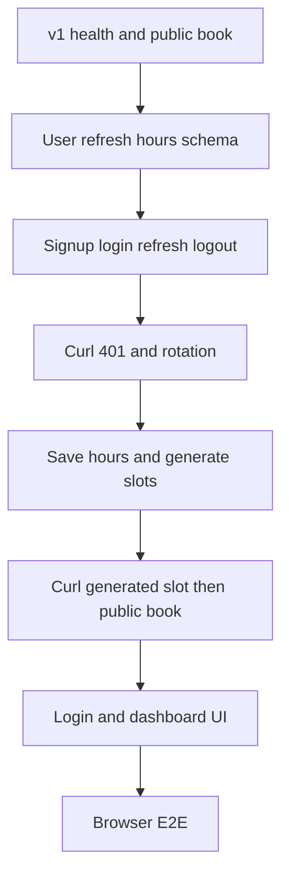

# BookMe v2 — how to approach it

The brief is [booking-saas-project-brief.txt.md](booking-saas-project-brief.txt.md). v1 is done: one tenant, seeded slots, `GET /api/slots`, `POST /api/bookings` with unique `slotId` → 409, and a public page at `/`.

v2 is only: **one owner can sign up and log in, set working hours and slot length, and generate bookable slots from those hours.** The public guest flow from v1 stays unauthenticated.

## Start with the backend

Do **backend first**, then a thin dashboard. v2’s value is three contracts you can curl:

1. A password becomes a short-lived access token and an httpOnly refresh cookie.
2. Working hours are rows in Postgres, not form state.
3. Generation writes real `Slot` rows the existing public `GET /api/slots` already returns.

A dashboard that only stores hours in React is a mock. An API that generates slots you can book on the existing page is the product.

Order:

1. Prove v1 still works
2. Schema for owner, refresh tokens, hours, timezone, duration
3. Auth HTTP contract (signup, login, refresh, logout, 401)
4. Hours + generate HTTP contract
5. Then React: login, protected dashboard, leave `/` as the guest book page

Do not start v3 (many businesses, `/book/:slug`, tenant-scoping middleware, team roles) until this loop works. There is still **one** `Tenant` row. The owner is attached to that tenant. Signup does not create a second business.

## What “done” means for v2

The owner can create an account, log in, set Mon–Fri hours plus a slot length and timezone, generate upcoming slots, and reload the dashboard without typing the password again until the refresh token expires or they log out.

A guest who never logs in can still open `/`, see those generated open times, book one, and get a 409 if that slot is already booked.

**Out of scope:** a second tenant, `/book/:slug`, tenant middleware, roles, invites, services, Stripe, email, sockets, buffers, blocked dates, TanStack Query, React Hook Form.

**Keep from v1:** unique `Booking.slotId`, Zod on every new body, public routes with no auth header, `npm run dev` starting client and API together via [scripts/dev.mjs](scripts/dev.mjs).

---

## Phase 0 — Confirm v1 still holds

Do this before new models.

- `GET http://localhost:5000/api/health` returns `{ ok: true, database: "connected" }`.
- `GET /api/slots` returns unbooked slots for the seed tenant (name included).
- `POST /api/bookings` still returns 201, then 409 for the same `slotId`.
- `/` still lists times and books through the Vite proxy.

If health is 503, stop. Do not add auth on a dead connection.

---

## Phase 1 — Data model (backend)

Edit [server/prisma/schema.prisma](server/prisma/schema.prisma). Extend the existing `Tenant`; do not replace the booking tables.

- **Tenant** — add `timezone` (IANA string, default `UTC`) and `slotMinutes` (int, default `30`).
- **User** — `id`, `email` (unique, stored lowercase), `passwordHash`, `tenantId`. One owner in v2: the user points at the seed tenant. No roles column.
- **RefreshToken** — `id`, `userId`, `tokenHash` (unique), `expiresAt`, `revokedAt` (nullable), `replacedById` (nullable). Store a hash of the cookie value, never the raw token.
- **AvailabilityRule** — `id`, `tenantId`, `weekday` (0 = Sunday … 6 = Saturday), `startMin`, `endMin` (minutes from local midnight). `@@unique([tenantId, weekday])`. One window per weekday is enough. Closed days are missing rows, not zeros.

`Slot` and `Booking` stay as they are. Generated slots are normal `Slot` rows so the public book path does not grow a second table.

Then:

1. From `server`: migrate with a name like `v2_auth_availability`.
2. Update [server/prisma/seed.ts](server/prisma/seed.ts) so the demo tenant has a timezone and `slotMinutes`, and still has future slots. Do not seed a password. The owner signs up through the API.
3. Re-seed and check: 1 tenant, N slots, 0 users, 0 refresh tokens, 0 availability rules.

**Pause until:** you can see the new columns and tables, and v1 `GET /api/slots` still returns rows.

---

## Phase 2 — Auth API (backend), still no dashboard

Add `bcrypt` and `jsonwebtoken`. Read secrets from env (`JWT_ACCESS_SECRET`, refresh pepper or `JWT_REFRESH_SECRET`). Validate new env with Zod next to the existing server config. Access token lifetime is short (about 15 minutes). Refresh token lifetime is days.

Cookies: `refreshToken` is **httpOnly**, `sameSite: lax`, `path` limited to the auth routes, `secure` only when not on localhost. Do not put tokens in `localStorage`.

Keep public booking in [server/src/index.ts](server/src/index.ts). Put password hashing, token issue/rotate, and the auth middleware in a small `server/src/auth.ts` so booking code stays obvious.

**`POST /api/auth/signup`**

- Body: `{ email, password, name }` for the owner. Password minimum length enforced by Zod.
- If a user already exists, **409**. v2 has one owner for the seed tenant.
- Hash with bcrypt. Create the user on the existing tenant (the seeded one).
- Set the refresh cookie and return `{ accessToken, user: { id, email } }` with **201**. Do not return the password hash.

**`POST /api/auth/login`**

- Same body shape without `name`. Unknown email or bad password → **401** with the same error text for both (no account enumeration).
- Success → new refresh cookie + `{ accessToken }`.

**`POST /api/auth/refresh`**

- Read the cookie. Missing, unknown, revoked, or expired → **401** and clear the cookie.
- On success, revoke the presented token, insert a new hash, set the new cookie, return a new access token. Reuse of an already-revoked token revokes the rest of that user’s live refresh tokens (rotation theft signal).

**`POST /api/auth/logout`**

- Revoke the presented refresh token and clear the cookie. **204**.

**`GET /api/me`**

- `Authorization: Bearer <accessToken>`. Missing or bad token → **401**. Success → `{ id, email, tenantId }`.

No signup of a second tenant. No password reset email.

**Pause until you can curl:**

1. Signup returns 201 and a `Set-Cookie` for `refreshToken`.
2. Second signup returns **409**.
3. Login with a wrong password returns **401**.
4. `GET /api/me` without a bearer token returns **401**.
5. `GET /api/me` with the access token returns the user.
6. `POST /api/auth/refresh` with the cookie returns a new access token, and the previous refresh cookie no longer works.
7. Logout, then refresh, returns **401**.
8. `GET /api/slots` and `POST /api/bookings` still work with no cookie and no bearer token.

---

## Phase 3 — Working hours and slot generation (backend)

Still curl, no dashboard. All of these routes use the auth middleware. The tenant id comes from the user row, not from the client body.

**`GET /api/availability`**

- Returns `{ timezone, slotMinutes, rules: [{ weekday, startMin, endMin }] }`.

**`PUT /api/availability`**

- Body: `{ timezone, slotMinutes, rules }`.
- Zod: IANA timezone the runtime can resolve, `slotMinutes` one of `15 | 30 | 45 | 60`, each rule’s `endMin > startMin`, weekday in `0..6`, no duplicate weekdays.
- Replace that tenant’s rules in one transaction and save timezone + duration on `Tenant`.
- **200** with the saved document.

**`POST /api/slots/generate`**

- Body: `{ from, to }` as dates (`YYYY-MM-DD`) in the **tenant timezone**, max range 14 days.
- For each local day in the range, if that weekday has a rule, walk from `startMin` to `endMin` in `slotMinutes` steps.
- Convert each window to UTC `startsAt` / `endsAt` with the tenant timezone (DST-safe: use the timezone, do not add a fixed offset).
- Insert a `Slot` only when that tenant does not already have a slot with the same `startsAt`.
- Never delete or move a slot that has a booking.
- Skip windows that start in the past.
- **201** with `{ created: number }`.

The public list does not change shape. After generate, `GET /api/slots` (no auth) includes the new open rows and still hides booked ones.

**Pause until you can curl:**

1. `PUT /api/availability` without a bearer token returns **401**.
2. With a token, save Mon–Fri 09:00–17:00, 30 minutes, and a real IANA timezone.
3. `POST /api/slots/generate` for the next few days returns `created > 0`.
4. Run generate again: `created` is 0 (or only slots that were not already there). Existing bookings remain.
5. `GET /api/slots` shows a generated slot. Booking it still returns 201, then 409.

---

## Phase 4 — Dashboard (frontend)

The UI is a client of the auth and availability APIs. Do not generate slots in the browser.

1. Keep `/` as the public book page in [client/src/App.tsx](client/src/App.tsx). Add `/login`, `/signup`, and `/dashboard`.
2. Access token lives in memory (React state or a module variable). On load, `POST /api/auth/refresh` with `axios` `withCredentials: true` so the httpOnly cookie is sent through the Vite proxy. Refresh failure leaves the user logged out.
3. `/dashboard` redirects to `/login` when there is no session. Signup and login store the access token and go to the dashboard.
4. Dashboard shows email, timezone, slot length, and seven weekday rows (start/end or closed). Save calls `PUT /api/availability`. Generate calls `POST /api/slots/generate` for a short range (default the next 7 days) and shows how many slots were created.
5. After generate, the public `/` page, once reloaded or refetched, lists those times. Booking still uses `POST /api/bookings`.
6. Logout calls `POST /api/auth/logout` and drops the access token.

Send `Authorization` only to `/api/me`, `/api/availability`, and `/api/slots/generate`. Do not send it on the public book requests.

No TanStack Query. `useState` + `useEffect` is enough. Axios is already the client.

**Pause until:** a new owner can sign up in the browser, save hours, generate, open `/` in a second tab, and book one generated slot.

---

## Phase 5 — End-to-end check

- Health still 200 after the v2 migration.
- Wrong password never creates a session. Signup twice returns 409.
- Reload `/dashboard`: the refresh cookie restores the session. Logout then reload lands on login.
- Generate does not duplicate slots and does not delete a booked slot.
- Two tabs booking the same generated slot: first 201, second 409, slot leaves the public list.
- Restart the API: the user row, hours, and slots are still in Postgres. The access token dies on restart only if it was memory-only on the server (it should be stateless JWT). The refresh cookie still works until expiry.

---

## Step-by-step cheat sheet

Work in this order; do not skip the curl pauses.

1. v1 health, list, book, 409
2. Prisma user, refresh token, availability, timezone, duration
3. Signup, login, refresh rotation, logout, `/api/me`
4. Curl 401s and cookie reuse
5. `PUT /api/availability` and `POST /api/slots/generate`
6. Curl a generated slot through the existing public book route
7. Login, signup, protected dashboard
8. Browser generate, then guest book and two-tab 409

If something fails, fix that layer. Do not add a second business, Stripe, or email to “make progress.”

## After v2 (not this plan)

The brief’s next wall is v3: many owners, each with their own tenant, public `/book/:slug`, and every query scoped by `tenant_id`. Roles and invites stay in that version. Payments, mail, and live slot updates stay in v4 and v5.
